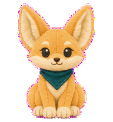
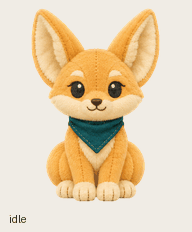

<div align="center">

# Mudaqqiq · مدقّق

**An animated AI companion for ChatGPT Work**

رفيق ذكاء اصطناعي متحرك مخصص لوضع Work في ChatGPT



[](https://raw.githubusercontent.com/abinadwan/mudaqqiq-pet/main/mudaqqiq-v2.png)

[English installation](#installation) · [طريقة التثبيت بالعربي](#arabic-installation) · [Project files](#project-files)

</div>

## About

Mudaqqiq is a custom animated pet designed for ChatGPT Work, inspired by precision, curiosity, and attention to detail. It is a visual companion, not a separate AI model, plugin, or task-execution engine.

| Specification | Value |
| --- | --- |
| Sprite version | V2 |
| Format | Transparent PNG |
| Dimensions | 1536 × 2288 px |
| File size | 3,117,916 bytes (approximately 2.97 MiB) |
| Animation states | 9 |
| Look directions | 16 |

## Installation

### ChatGPT Work on the web

1. [Download mudaqqiq-v2.png](https://raw.githubusercontent.com/abinadwan/mudaqqiq-pet/main/mudaqqiq-v2.png). Save the original PNG without resizing or converting it.
2. Open [ChatGPT](https://chatgpt.com/) and sign in.
3. Go to **Settings → Personalization → Pet → Select pet → Upload pet**.
4. Fill in the upload dialog:

   | Field | Value |
   | --- | --- |
   | Pet name | Mudaqqiq |
   | Pet description (optional) | Mudaqqiq is an animated AI companion inspired by precision, curiosity, and attention to detail. Designed for ChatGPT Work by ABINADWAN, with nine animation states and sixteen look directions. |
   | Sprite sheet | `mudaqqiq-v2.png` |

5. Click **Upload**, then select Mudaqqiq in the pet picker.
6. Open a supported Work chat to see the pet.

> **Compatibility:** The upload dialog observed during this project accepts transparent PNG or WebP files at 1536 × 1872 (V1) or 1536 × 2288 (V2), up to 20 MiB. Some versions of the official web documentation list V1 only. Check that your own upload dialog explicitly supports V2. If it does not, this V2 file may be rejected; do not resize it arbitrarily. Availability depends on your account, workspace, and interface. Successful installation has not been independently tested here.

No ZIP extraction, coding, or plugin installation is required to upload the pet.

### ChatGPT desktop app

The desktop app has a separate pet picker under **Settings → Pets**. If your version supports installing a custom V2 pet, follow its import flow, choose Mudaqqiq, and enter `/pet` to show or hide the floating companion. Web uploads and locally installed desktop pets may not sync. See the [official Pets guide](https://learn.chatgpt.com/docs/pets) for current desktop options.

<a id="arabic-installation"></a>

## طريقة التثبيت بالعربي

<div dir="rtl">

1. حمّل [ملف الشخصية الأصلي mudaqqiq-v2.png](https://raw.githubusercontent.com/abinadwan/mudaqqiq-pet/main/mudaqqiq-v2.png) واحفظه دون تغيير أبعاده.
2. افتح [ChatGPT](https://chatgpt.com/) وسجّل الدخول.
3. من الإعدادات، اختر التخصيص ثم Pet ثم Select pet ثم Upload pet.
4. اكتب اسم الشخصية **Mudaqqiq** أو **مدقّق**.
5. أضف الوصف الاختياري التالي: «مدقّق رفيق متحرك لوضع Work، مستوحى من الدقة والفضول والاهتمام بالتفاصيل. يضم تسع حالات حركة وستة عشر اتجاهًا للنظر، من تصميم ABINADWAN».
6. في خانة Sprite sheet اختر ملف `mudaqqiq-v2.png`.
7. اضغط Upload ثم اختر الشخصية وافتح محادثة Work مدعومة.

**ملاحظة التوافق:** تأكد من أن نافذة الرفع تدعم V2 بأبعاد 1536 × 2288 بكسل. الحد الأقصى الظاهر في نافذة الرفع هو 20 MiB. بعض الواجهات قد تدعم V1 فقط. لا تحتاج إلى تحميل الأرشيفات أو فك ضغطها لتثبيت الشخصية.

في تطبيق سطح المكتب، توجد إعدادات مستقلة للشخصيات ضمن Settings → Pets. راجع خيارات الاستيراد المتاحة في إصدارك، واستخدم الأمر `/pet` لإظهار الشخصية العائمة أو إخفائها بعد تثبيتها.

</div>

## Previews

| Motion | Idle |
| --- | --- |
|  |  |

- [Animation contact sheet](./mudaqqiq-contact-sheet.png)
- [Sixteen look directions](./mudaqqiq-directions.png)
- [Still frames](./mudaqqiq-stills.png)
- [Full V2 sprite sheet](./mudaqqiq-v2.png)

## Project files

The seven original archives have been extracted into browsable folders. The original ZIP files remain available for download.

| Part | Browse extracted files | Original archive |
| --- | --- | --- |
| 1 | [Browse](./extracted/mudaqqiq-project-01/) | [ZIP](./mudaqqiq-project-01.zip) |
| 2 | [Browse](./extracted/mudaqqiq-project-02/) | [ZIP](./mudaqqiq-project-02.zip) |
| 3 | [Browse](./extracted/mudaqqiq-project-03/) | [ZIP](./mudaqqiq-project-03.zip) |
| 4 | [Browse](./extracted/mudaqqiq-project-04/) | [ZIP](./mudaqqiq-project-04.zip) |
| 5 | [Browse](./extracted/mudaqqiq-project-05/) | [ZIP](./mudaqqiq-project-05.zip) |
| 6 | [Browse](./extracted/mudaqqiq-project-06/) | [ZIP](./mudaqqiq-project-06.zip) |
| 7 | [Browse](./extracted/mudaqqiq-project-07/) | [ZIP](./mudaqqiq-project-07.zip) |

The project archive includes final assets, source artwork, generation prompts, extracted frames, previews, and validation reports.

## Quality and validation

The [local quality report](./mudaqqiq-quality.json) records a successful validation (`ok: true`) with no errors and several warnings related to look-direction transitions and transparency. It records the following SHA-256 for the validated sprite:

```text
88d37e41fc4d77cc957d77679b05da3fc44a14b9fc2f02c3c338b454b3ff7aee
```

The report is not a guarantee of acceptance by every ChatGPT client.

## Troubleshooting

| Issue | What to check |
| --- | --- |
| Upload rejected | Confirm V2 support, original dimensions, PNG format, and the 20 MiB limit. |
| Pet option missing | Confirm that Pets and Work are available for your account and workspace. |
| Animation not visible | Open a supported Work chat; in the desktop app, wake the pet and check reduced-motion settings. |
| Wrong file downloaded | Download the original sprite sheet rather than the GIF preview or ZIP archives. |

## Credits

Created by [ABINADWAN](https://github.com/abinadwan).

An independent custom pet project; not an official OpenAI product.

[Official ChatGPT Pets documentation](https://learn.chatgpt.com/docs/pets) · [Report an issue](https://github.com/abinadwan/mudaqqiq-pet/issues)
